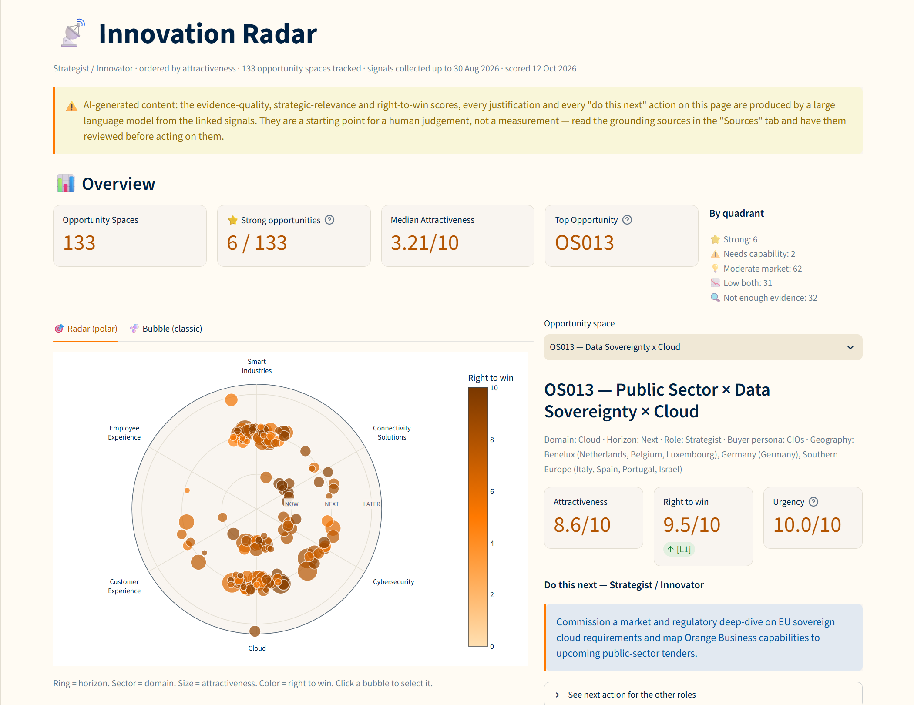
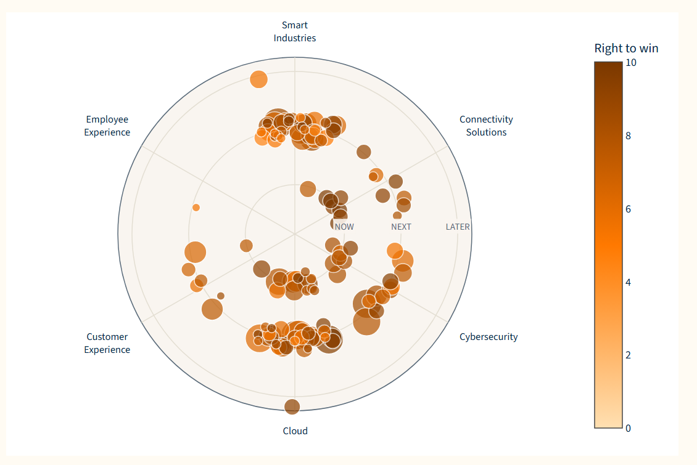
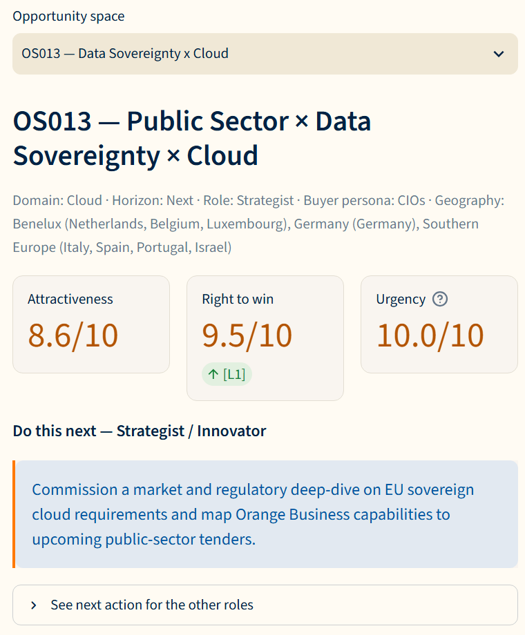

# Innovation Radar

Turns external market signals (news, research, regulation, public procurement) into scored, ranked Opportunity Spaces for an Orange Business use case, and shows them in an interactive dashboard.

**Live demo:** https://orangebusinessusecase.streamlit.app/



## What it does

- **Ingest**: pulls signals from 9 sources (Google News, NewsAPI.ai, GDELT, arXiv, Semantic Scholar, vendor blogs, Hacker News, EUR-Lex, TED); each source is isolated, so one failure never blocks the others.
- **Link**: attaches a signal to an opportunity space only when its title shares at least 2 keywords with the space's use case and technology.
- **Score**: Attractiveness (five sub-scores, AHP weights), Right-to-Win (portfolio distance L0-L4) and Urgency, mixing arithmetic and LLM judgements.
- **Promote**: recurring themes become new opportunity spaces; a watchlist-to-proposal loop lets the taxonomy grow.
- **Visualize**: a Streamlit dashboard (radar and bubble views, role-based next actions), a Markdown summary, and a CSV export for Power BI.

## Run it

```bash
pip install -r requirements.txt
cp .env.example .env                 # add at least one LLM key (see below)
python radar_cli.py all              # full pipeline: ingest -> analyze -> link -> score -> summary
streamlit run app/streamlit_app.py   # dashboard on http://localhost:8501
```

The repository ships a ready `radar.db`, so the dashboard works without running the pipeline.

With Docker: `docker compose up --build` serves the dashboard on http://localhost:8505, and `docker compose run --rm dashboard python radar_cli.py all` runs the pipeline in the same image.

## Configuration

Set in `.env` (template: `.env.example`). Only the variables the code reads are listed.

| Variable | Purpose |
|---|---|
| `LLM_PROVIDER` | `auto` (Groq, then SambaNova, then Ollama), `groq`, `sambanova` or `ollama` |
| `GROQ_API_KEY` (`_2` to `_5`, `GROQ_MODEL`) | Groq key; the extra keys rotate on rate limits |
| `SAMBANOVA_API_KEY`, `SAMBANOVA_MODEL` | SambaNova fallback |
| `OLLAMA_URL`, `OLLAMA_MODEL` | Local Ollama fallback |
| `NEWSAPI_AI_KEY` | NewsAPI.ai source (skipped when unset) |
| `SEMANTIC_SCHOLAR_API_KEY` | Optional, avoids rate limits on Semantic Scholar |

## Structure

```
pipeline/     ingest, analyze, scoring, AHP weights, taxonomy, SQLite layer (db.py), config
llm/          provider-agnostic LLM client (Groq -> SambaNova -> Ollama)
app/          Streamlit dashboard and the Power BI project (.pbip)
dags/         Airflow DAG running the same stages as `radar_cli.py all`
scripts/      export_powerbi.py, derive_caps.py, rtw_bonus_sensitivity.py, update-all.*
tests/        offline test suite (network blocked by conftest.py)
docs/         decisions.md, technical_deep_dive.md
radar_cli.py  CLI entry point (create, promote, link, scores, summary, all, ...)
radar.db      committed SQLite snapshot served by the deployed dashboard
```

## Tests and CI

```bash
pip install -r requirements-dev.txt
python -m pytest -q      # offline; add --cov=pipeline --cov=llm --cov=radar_cli --cov=app for coverage
ruff check .
```

GitHub Actions (`.github/workflows/tests.yml`) runs lint, the tests with coverage, the DAG tests against Airflow 2.10, and the Docker build; the suite also runs inside the image's `test` stage.

## Deployment

- **Render / Docker**: `render.yaml` builds the `Dockerfile` (last stage, no test tooling) and serves the committed `radar.db`; commit a new database to refresh it.
- **Streamlit Community Cloud**: point it at `app/streamlit_app.py`; no secret is needed.
- **Airflow**: `dags/innovation_radar.py` schedules the pipeline daily (`requirements-airflow.txt`, separate Python 3.12 environment).

## Limitations

- **A snapshot**: the dashboard shows the last committed `radar.db`; it only moves when the pipeline is re-run and the database committed.
- **LLM judgements**: evidence quality, strategic relevance, right-to-win and next actions come from a language model and vary between runs; treat them as a starting point, not a measurement.
- **Public data only**: right-to-win is judged against the public Orange Business portfolio, and weights and thresholds are not fitted to won/lost outcomes.

## Origin and credits

Started as a BeCode team assignment with Hiba, Irene and Gaetan; the team's version lives in [its own repository](https://github.com/amellalajiba-sys/Orange_use_case) and was left untouched. This repository is my own continuation of that work.

## More

[Technical deep dive](docs/technical_deep_dive.md) (architecture, formulas, modules, LLM use) | [Decision log](docs/decisions.md) | [Security policy](SECURITY.md)

<details>
<summary>More screenshots</summary>




</details>
