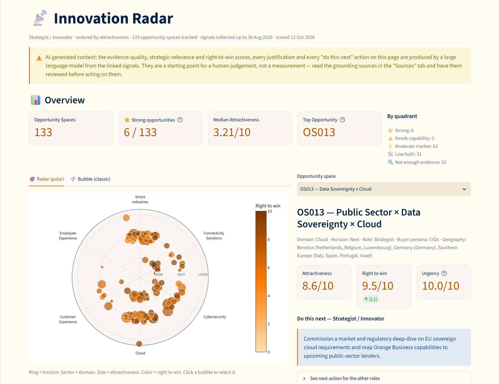
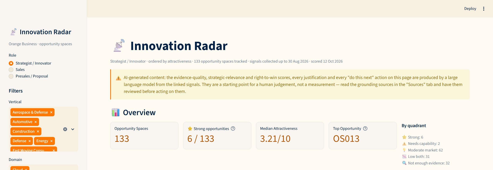
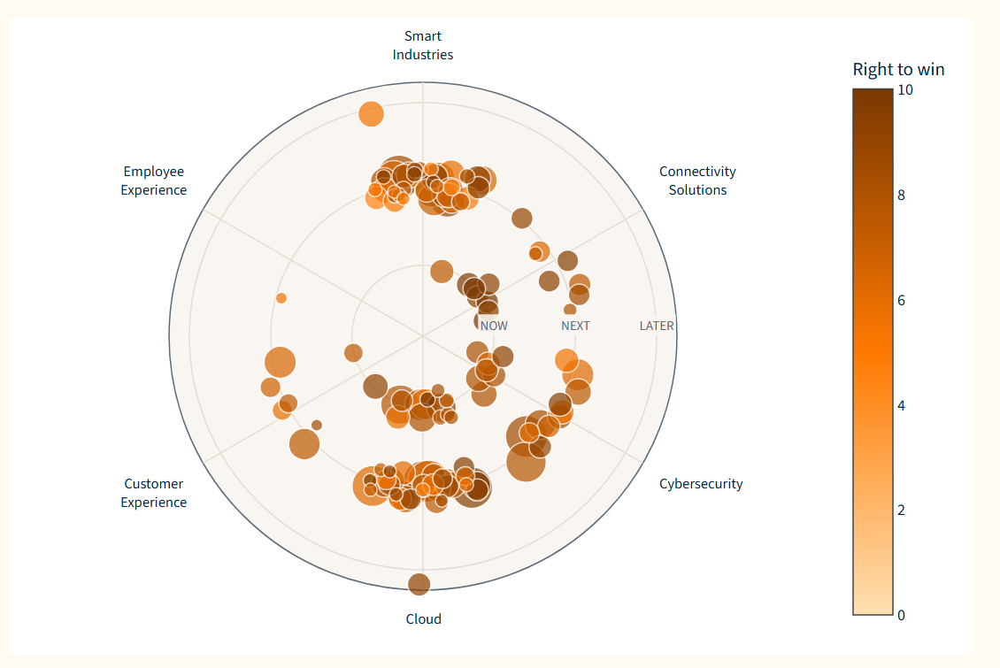
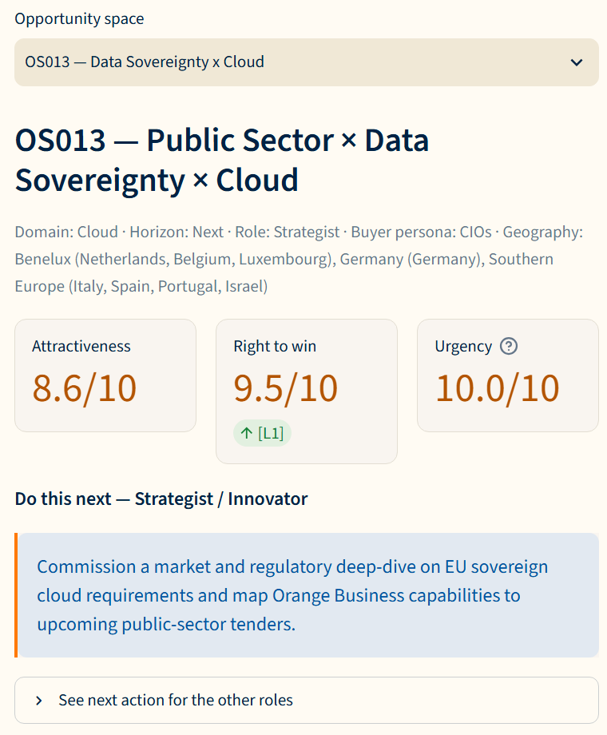
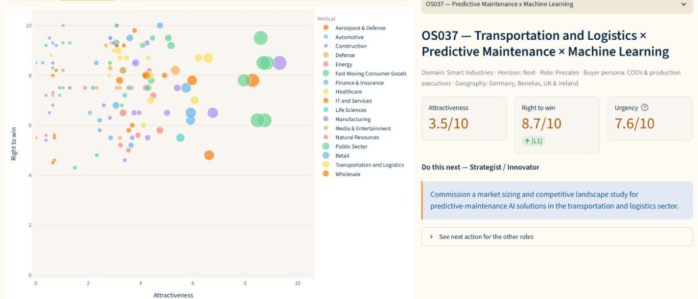
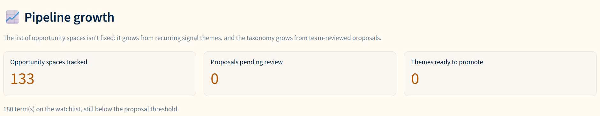

# Innovation Radar

A signal-driven opportunity discovery tool built for an Orange Business use case. It ingests external market signals (news, research, regulation, public procurement...), scores them into ranked Opportunity Spaces, and surfaces them through an interactive dashboard.

**Live demo:** https://orangebusinessusecase.streamlit.app/



## Origin and credits

This project started as a BeCode team assignment for an Orange Business use case, built with Hiba, Irene and Gaetan. The team's final version lives in the [team repository](https://github.com/amellalajiba-sys/Orange_use_case) and was left untouched. This repository is my own continuation of that work: after the team delivery I kept developing and improving the radar here, on my own.

What changed compared with the team's final version (`main`, 11 September 2026), measured on both repositories:

| | Team version | This repository |
|---|---|---|
| Automated tests | 60 tests in 2 files | 215 tests (196 test functions) in 13 files, run with the network blocked |
| CI / deployment | none (dev container only) | GitHub Actions (tests + Docker build on every push), Dependabot, Docker, Render, live Streamlit app |
| Attractiveness weights | hand-set 30/25/20/15/10 | derived with AHP from a pairwise-comparison sheet (consistency ratio 0.021); the hand-set weights remain an option |
| Signal-to-space linking | 2,899 links, every space linked, no relevance check | 469 links, each sharing at least 2 keywords with the space; 32 spaces without real evidence are flagged "insufficient evidence" instead of being scored on unrelated signals |
| Data | 3,926 signals, 125 opportunity spaces | 4,272 signals, 133 opportunity spaces |
| Score history | latest score only | every accepted score kept in `score_history` / `right_to_win_history`, so runs can be compared |
| Power BI | `.pbix` fed by Excel exports | `.pbix` + PBIP project (diffable in git) fed by a tested CSV export script |
| Guardrails | — | signal titles fenced as untrusted data in LLM prompts (prompt-injection defence), LLM scores clamped to 0-10 with nan/inf sent to a fallback, 20 s timeout on feed downloads, foreign keys enforced in SQLite, only http(s) source links made clickable, AI-generated content disclosed on the dashboard (AI Act), security policy |

How the scores are computed, why the code is built this way, and what is still open: [technical deep dive](docs/technical_deep_dive.md). Dated decisions: [docs/decisions.md](docs/decisions.md).

## What it does

I built a pipeline that turns scattered external signals into scored, ranked opportunity spaces. The committed `radar.db` holds 4,272 signals collected from the 9 sources (last collection 30 August 2026) and 133 opportunity spaces, all scored on 12 October 2026: 27 hand-picked seeds (`pipeline/config.py::CANDIDATES`) plus 106 promoted from recurring themes. 101 of the 133 have at least one linked signal; the other 32 are shown as "insufficient evidence".

- **Ingest**: pulls signals from 9 sources (Google News, NewsAPI.ai, GDELT, arXiv, Semantic Scholar, vendor blogs, Hacker News, EUR-Lex, TED), each isolated so one failing source never blocks the rest.
- **Link**: attaches signals to the opportunity space they actually support (a title must share at least 2 distinct keywords with the space's use case and technology, `radar_cli.py::MIN_KEYWORD_OVERLAP`), before any scoring happens.
- **Score**: two independent axes — Attractiveness (market signal strength 39.7%, evidence quality 27.8%, source diversity 14.1%, strategic relevance 13.0%, novelty/momentum 5.5% — the AHP priority vector of `pipeline/ahp_weights.xlsx`, consistency ratio 0.021; the hand-set 30/25/20/15/10 remains as `--weights=manual`) and Right-to-Win (portfolio distance L0–L4) — plus a separate Urgency score, combining LLM judgment (Groq, falling back to SambaNova, then a local Ollama model) and deterministic formulas. The dashboard calls an opportunity "strong" when both axes are >= 7 (`pipeline/config.py::STRONG_THRESHOLD`); a space with no linked signal is classed "insufficient evidence" instead, whatever its scores.
- **Promote**: recurring themes are promoted into new tracked Opportunity Spaces; a separate taxonomy-extension loop (watchlist → proposal → accepted/rejected) lets the underlying vocabulary grow over time.
- **Visualize**: a Streamlit dashboard (radar + bubble view, where a click on either opens that opportunity space in the detail panel; role-based next actions; the dates of the last signal collection and scoring run under the title; a pipeline-growth section showing proposals and themes waiting to become new spaces) and a Power BI export for reporting. The page opens on the top space for the current role and filters: the best on attractiveness + right-to-win, the two axes a strong opportunity needs.

## Repository structure

```
.
├── pipeline/
│   ├── config.py               # taxonomy, thresholds, source lists
│   ├── ingest.py                # per-source connectors + safe_run() isolation
│   ├── analyze.py               # theme/OS extraction from raw signals
│   ├── scoring.py               # attractiveness + right-to-win scoring, LLM calls
│   ├── ahp.py                   # AHP weights + consistency ratio from ahp_weights.xlsx
│   ├── ahp_weights.xlsx         # AHP pairwise comparisons of the five attractiveness sub-scores
│   ├── taxonomy_validation.py   # generic-term filtering
│   ├── extend_taxonomy.py       # watchlist -> proposal workflow
│   ├── theme_promotion.py       # tracks valid themes across runs, feeds promote
│   ├── latest_scores.py         # prints the most recent score per opportunity space
│   ├── signals_discovery.py     # older copy of theme tracking, used by radar_cli_top_15.py
│   └── db.py                    # SQLite access layer (radar.db)
├── llm/
│   └── llm_client.py            # provider-agnostic LLM client (Groq -> SambaNova -> Ollama)
├── app/
│   ├── streamlit_app.py         # interactive dashboard
│   ├── innovation_radar_dashboard.pbip  # Power BI project (open this one)
│   ├── innovation_radar_dashboard.Report/        # report pages and visuals (part of the .pbip)
│   ├── innovation_radar_dashboard.SemanticModel/ # tables, relationships, DAX measures (part of the .pbip)
│   ├── innovation_radar_dashboard.pbix  # previous Power BI file, kept as backup
│   └── powerbi_data/            # CSV export of radar.db read by Power BI (generated)
├── radar_cli.py                  # CLI entry point (create/promote/link/summary/all/...)
├── radar_cli_top_15.py           # older CLI, kept on purpose (see docs/decisions.md)
├── opportunity_spaces_summary.md         # client-facing summary, all opportunity spaces (generated)
├── opportunity_spaces_summary_top_15.md  # same, top 15 by attractiveness (generated)
├── screenshots/                  # dashboard screenshots (shown in the README)
├── conftest.py                   # repo root on sys.path + autouse fixture blocking all sockets
├── tests/
│   ├── test_LLM.py               # malformed/missing LLM output handling, key rotation
│   ├── test_export_powerbi.py    # Power BI CSV export: dates, missing values, DataFolder check
│   ├── test_scoring_and_db.py    # scoring formulas, DB queries, dashboard quadrants
│   ├── test_score_history.py     # every score write kept in the history tables, current reads unchanged
│   ├── test_taxonomy_threshold.py # one taxonomy proposal threshold for every entry point
│   ├── test_dashboard.py         # Streamlit dashboard: missing DB, AI disclosure, tabs, links, chart clicks, opening view
│   ├── test_foreign_keys.py      # foreign keys enforced, child tables repaired onto the live parent
│   ├── test_network_guard.py     # the socket guard in conftest.py
│   ├── test_link_keywords.py     # link needs 2 shared keywords, weak links pruned
│   ├── test_ahp_weights.py       # AHP weights, consistency ratio, manual option
│   ├── test_rtw_bonus.py         # right-to-win customer-reference bonus and its sensitivity
│   ├── test_derive_caps.py       # market/diversity caps derived from the link volume
│   └── test_llm_chain.py         # provider chain Groq -> SambaNova -> Ollama
├── scripts/                      # one-off analysis scripts, run from the repo root
│   ├── export_powerbi.py         # radar.db -> app/powerbi_data/*.csv for Power BI
│   ├── analyze_healthcare.py     # vertical deep-dive report
│   ├── check_healthcare.py       # vertical diagnostic query
│   ├── rtw_bonus_sensitivity.py  # what moves if the right-to-win customer-reference bonus changes
│   └── derive_caps.py            # re-derives MARKET_SIGNAL_CAP / SOURCE_DIVERSITY_CAP from the link volume
├── docs/
│   ├── decisions.md              # dated decision log
│   └── technical_deep_dive.md    # score formulas, modules, bugs fixed, open issues
├── radar.db                      # SQLite database (6.8 MB, tracked on purpose: Streamlit Cloud deploys from the repo and cannot run the pipeline)
├── .env.example                   # required environment variables (no real keys)
├── requirements.txt
└── README.md
```

## Setup

```bash
git clone https://github.com/Siegried81/Orange_Business_use_case
cd Orange_Business_use_case
pip install -r requirements.txt
cp .env.example .env   # fill in your own API keys
```

## Usage

```bash
python radar_cli.py all            # db -> ingest -> analyze -> extend_taxonomy -> create -> promote -> link -> scoring -> summary
python -m streamlit run app/streamlit_app.py
```

Individual steps:

```bash
python -m pipeline.ingest          # collect signals
python -m pipeline.analyze         # extract candidate themes (LLM)
python radar_cli.py create         # register seed opportunity spaces
python radar_cli.py promote        # register recurring themes
python radar_cli.py link           # attach signals to each opportunity space
python -m pipeline.scoring         # score (LLM); --refresh recomputes the deterministic sub-scores only
                                   # --weights=manual uses the hand-set 30/25/20/15/10 instead of the AHP weights
                                   # exits non-zero if no LLM provider answered: the previous real scores are kept, not overwritten
python -m pipeline.scoring --rescue-fallback   # re-score the spaces still sitting on a neutral fallback
python radar_cli.py summary        # write opportunity_spaces_summary.md
python radar_cli.py summary --top 15 --output opportunity_spaces_summary_top_15.md
python radar_cli.py review         # approve/reject taxonomy proposals
python -m pytest                   # run the 215 tests (sockets are blocked by conftest.py, so no network is possible)
```

Power BI dashboard (Power BI has no SQLite connector, so it reads a CSV export):

```bash
python scripts/export_powerbi.py   # radar.db -> app/powerbi_data/*.csv
```

Then open `app/innovation_radar_dashboard.pbip` and click Refresh. The CSV folder is the
`DataFolder` parameter (Transform data > Manage parameters). It holds an absolute path,
so set it on a fresh clone or if the repo moves; the export script prints a warning with
the value to use when it does not match.

## Deploying

- **Docker**: `docker compose up --build` serves the dashboard on
  http://localhost:8505 with the host's `radar.db` mounted in, and
  `docker compose run --rm dashboard python radar_cli.py all` runs the
  pipeline in the same image with the keys from `.env`.
- **Render**: `render.yaml` deploys the same image as a free web service
  serving the committed `radar.db`; push a new database to refresh it. Not
  exercised by CI: the first deploy is the test.
- **Streamlit Community Cloud**: point it at `app/streamlit_app.py`;
  `requirements.txt` and `.streamlit/config.toml` are read as they are, and
  the dashboard needs no secret.

CI (`.github/workflows/tests.yml`) runs the suite and builds the image on
every push.

## Key challenges

- **LLM reliability**: the local Ollama fallback (used when Groq and SambaNova both fail) can return malformed or incomplete JSON. I built explicit fallback branches so a missing field degrades to a documented neutral score instead of crashing or corrupting the database — covered by `tests/test_LLM.py`.
- **Calibration on a moving dataset**: the urgency scale is re-derived on every run from the 95th percentile of the live opportunity-space population rather than hardcoded, since the dataset kept growing (133 spaces today) as sources came online. `radar_cli.py calibrate` prints signal-count percentiles to help choose how many signals `link` keeps per space. Near-duplicate signal detection still uses a fixed 0.85 similarity.
- **Data correctness under concurrency**: SQLite timestamp collisions (two scores inserted milliseconds apart on the same machine) could silently pick the wrong "latest" score; the latest-score queries in `pipeline/db.py` use a deterministic tiebreaker (`id DESC`), and `insert_score()` updates each opportunity space's row in place, so there is one current score per space; every accepted write is also appended to `score_history` / `right_to_win_history`, so successive runs can be compared without changing what the radar reads.

## Screenshots

<details>
<summary>Five more views of the dashboard (click to expand)</summary>

**Top of the page**: data dates under the title, the AI-generated content notice, and the overview.


**Radar**: ring = horizon, sector = domain, size = attractiveness, colour = right to win. A click on a bubble opens that space on the right.


**Detail panel of the top space (OS013)**: attractiveness, right to win with portfolio distance, urgency, and the next action for the selected role.


**Bubble view**: attractiveness against right to win, coloured by vertical, with OS037 open in the panel.


**Pipeline growth**: proposals and recurring themes waiting to become new opportunity spaces.


</details>

## Limitations

What a reader should know before trusting a number on the dashboard. The full list, with figures, is in the [technical deep dive, §8](docs/technical_deep_dive.md#8-reproducibility-honestly-and-open-issues).

- **A snapshot, not a live feed**: signals were collected up to 30 August 2026 and scored on 12 October 2026. The radar only moves when the pipeline is re-run and `radar.db` committed.
- **Public signals only**: right-to-win is judged against Orange Business's public portfolio, not its internal offers, sales or customer data, and evidence cannot move it.
- **LLM-generated judgements**: evidence quality, strategic relevance, right-to-win and next actions come from a language model at temperature 0. Two runs on the same signals moved 38 of 133 spaces to another right-to-win level, so they are a starting point for a human, not a measurement.
- **Keyword links**: a signal attaches to a space when its title shares 2 keywords with it. That removes most off-topic links but leaves 32 spaces with no evidence, shown as such.
- **Weights and thresholds are opinions made consistent, not fitted**: the AHP weights reflect one team's judgements, and the taxonomy thresholds were never calibrated, because there are no won/lost outcomes to fit them to.
- **Two rankings coexist**: the dashboard ranks the top space on attractiveness + right-to-win, while the Power BI report and `opportunity_spaces_summary_top_15.md` still rank on attractiveness alone.

## Next steps

**On the radar itself**
- Refresh signals on a schedule and keep every run in the score history, so the radar shows trends ("this space rose 2 points this month") instead of a snapshot.
- Align the Power BI report and the top-15 summary on the dashboard's two-axis ranking.
- Add sources in French, Dutch and German, where much of the EU public-procurement and regulatory signal is published.
- Replace keyword links with embedding similarity checked by keywords, and measure precision on a hand-labelled sample, as was done for the 2-keyword rule.
- Alert the owning team when a space crosses into the "strong" quadrant or when a tender deadline appears.

**With Orange Business data, in an internship**
- Connect the radar to internal data (offer catalogue, sales pipeline, customer references), so right-to-win is measured rather than inferred from public information.
- Map the innovation work Orange Business teams already run, so the radar builds on it instead of duplicating it.
- Run the AHP pairwise comparisons with each business unit, so the weights reflect Orange's priorities rather than a student team's, and show where the units disagree.
- Add a feedback loop: experts mark each top opportunity as relevant or not, which gives a measurable precision ("x% of the top 15 confirmed") and the outcomes needed to calibrate the weights and thresholds.
- Deploy inside Orange's environment (sovereign cloud, single sign-on, scheduled Power BI refresh), within the AI Act and GDPR constraints.

## Tech stack

Python, pandas, SQLite, Groq/SambaNova/Ollama (LLM scoring), Streamlit, Plotly, Power BI (export).